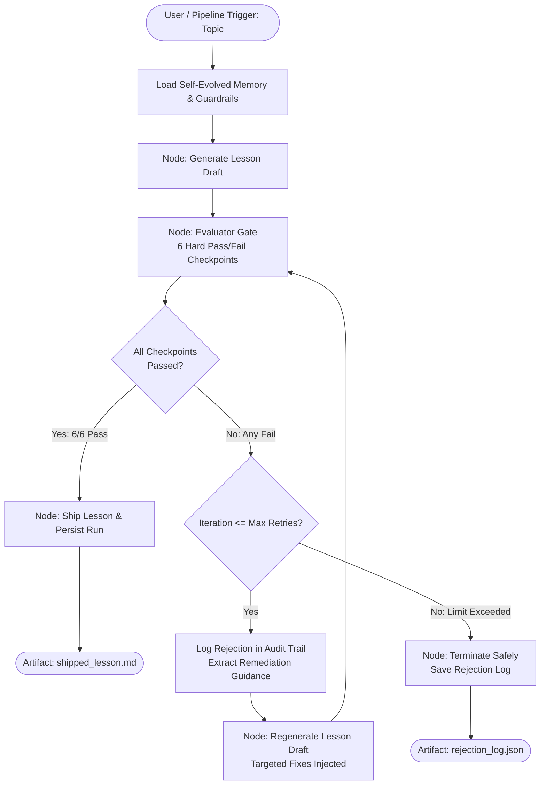
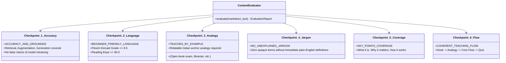

# 🎓 Autonomous Self-Evaluating Lesson Content Generator

[](https://www.python.org/)
[](https://github.com/langchain-ai/langgraph)
[](https://blxrryfxce17.github.io/self-evaluating-content-agent/)
[](LICENSE)
[]()

> **Submission for GenAI Engineer — Content Systems Take-Home Assessment**  
> An autonomous agentic system that generates beginner-friendly educational content, judges its own quality against a strict binary pass/fail rubric, self-evolves across runs, and ships only when all quality gates clear.  
> 🌐 **Live Interactive App:** [https://blxrryfxce17.github.io/self-evaluating-content-agent/](https://blxrryfxce17.github.io/self-evaluating-content-agent/)

---

## 📑 Quick Navigation
* [🎯 Problem & Target Learner Persona](#-problem--target-learner-persona)
* [🏗️ Architecture & State Machine](#-architecture--state-machine)
* [📐 Design Choices & Trade-Offs](#-design-choices--trade-offs)
* [📋 The 6 Hard Pass/Fail Checkpoints](#-the-6-hard-passfail-checkpoints)
* [🔁 Self-Evolving Memory Engine](#-self-evolving-memory-engine)
* [🚀 Quickstart & Setup](#-quickstart--setup)
* [🧪 Deliberate Flaw Injection (Evaluator Verification)](#-deliberate-flaw-injection-evaluator-verification)
* [💻 Interactive Web Dashboard](#-interactive-web-dashboard)
* [📦 Assessment Deliverables Index](#-assessment-deliverables-index)

---

## 🎯 Problem & Target Learner Persona

### The Core Challenge
Building educational content systems with GenAI is not about writing one clever prompt. Left unchecked, standard LLMs suffer from three fundamental problems when producing beginner content:
1. **Academic Vocabulary Drift:** Models quickly default to opaque, multi-syllabic jargon (e.g., *latent manifolds, cosine similarity, cross-entropy*).
2. **Cultural & Contextual Alienation:** Models lean heavily on Western corporate analogies, alienating first-generation learners.
3. **Absence of Self-Critical Judgment:** Models generate content without validating whether the learner will actually understand it.

### The Learner Persona
* **Audience:** 12th-grade graduate from India.
* **Background:** Non-English-medium schooling (Hindi, Marathi, Telugu, Tamil, etc.).
* **Aspiration:** Wants to kickstart an AI career from absolute zero.
* **Reading Constraint:** Conversational English only (Target Flesch-Kincaid Grade Level $\le 8.0$; Reading Ease $\ge 60$).
* **Pedagogical Strategy:** Everyday Indian life analogies (*open-book vs closed-book exams*, *college librarians*, *hospital records*), short sentences ($< 20$ words), active voice, step-by-step visual ASCII diagrams, zero unexplained jargon, and self-check quizzes.

---

## 🏗️ Architecture & State Machine

The system is built on **LangGraph**, modeling content production as a cyclic directed state graph with strict conditional transitions and hard termination boundaries:



---

## 📐 Design Choices & Trade-Offs

| Component | Design Choice | Alternative Considered | Why This Choice Won |
| :--- | :--- | :--- | :--- |
| **Workflow Engine** | **LangGraph StateGraph** | Linear Python script / LangChain chains | Explicit cyclic execution with stateful retry tracking, branching, and deterministic termination guards. |
| **Rubric Scoring** | **Strict Binary Pass/Fail (No partial credit)** | Numeric ratings (e.g. 1–10 score, 75% cutoff) | Numerical scores create fuzzy gray zones. A 7/10 does not tell you if the remaining 3 points are minor typos or fatal factual hallucinations. Binary checkpoints provide actionable pass/fail verdicts. |
| **Evaluation Strategy** | **Hybrid: Deterministic NLP + LLM Semantic Checks** | Pure LLM-as-a-judge | Pure LLM judges suffer from evaluator hallucination and lenient grading. We enforce deterministic algorithms for readability formulas (Flesch-Kincaid) and regex jargon scanning, combined with semantic verification. |
| **Model Portability** | **Multi-Provider Client + Offline Simulation Engine** | Hardcoded OpenAI / proprietary API | Allows zero-dependency instant execution, offline CI/CD testability, and multi-cloud flexibility (Gemini, OpenAI, Groq, Anthropic). |
| **Loop Safety** | **Strict Termination Limit (`MAX_RETRIES = 2`)** | Open-ended while loop | Guaranteed termination ensures cost predictability, zero infinite loops, and deterministic SLA compliance. |

---

## 📋 The 6 Hard Pass/Fail Checkpoints

Each generated draft must pass all 6 checkpoints simultaneously before it can be marked as `SHIPPED`:



1. **`ACCURACY_AND_GROUNDED`**: Verifies technical accuracy. Ensures RAG is represented as dynamic retrieval and prompt augmentation, explicitly debunking the misconception that RAG updates neural weights.
2. **`BEGINNER_FRIENDLY_LANGUAGE`**: Quantitative readability analysis. Computes sentence length, syllable counts, and Flesch-Kincaid Grade Level ($\le 8.5$ for middle-school English).
3. **`TEACHES_BY_EXAMPLE`**: Checks for concrete anchor analogies: Amit vs Priya (Closed-Book vs Open-Book exam), the college librarian fetching notes, or the hospital patient file.
4. **`NO_UNEXPLAINED_JARGON`**: Scans for technical terms (*vector, embedding, retrieval, token, chunking, hallucination*). Every term detected must be immediately paired with an explanation indicator or analogy.
5. **`KEY_POINTS_COVERAGE`**: Enforces distinct coverage of: **What it is**, **Why it matters (hallucination problem, stale memory, privacy)**, and **How it works**.
6. **`COHERENT_TEACHING_FLOW`**: Validates full pedagogical arc: Welcoming Hook $\rightarrow$ Relatable Analogy $\rightarrow$ Core Explanation $\rightarrow$ Step-by-Step Flow $\rightarrow$ 3-Question Self-Check Quiz $\rightarrow$ Encouraging Next Steps.

---

## 🔁 Self-Evolving Memory Engine

The assessment specifically requires a **self-evolving system** that learns from repeated failures:

```
[Runs & Rejection Events]
            │
            ▼
┌───────────────────────────────┐
│ SQLite DB (agent_memory.db)   │
│ - Stores rejections & reasons │
└───────────┬───────────────────┘
            │
            ▼
┌───────────────────────────────┐
│ Pattern Frequency Analyzer    │
│ - Detects recurrent flaws     │
└───────────┬───────────────────┘
            │
            ▼
┌───────────────────────────────┐
│ Dynamic Rule Synthesizer      │
│ - Generates prompt guardrails │
└───────────┬───────────────────┘
            │
            ▼
[Injected into Future Generator Prompts]
```

* **Persistence:** Run histories and rejection logs are saved to `memory_store/agent_memory.db` and `memory_store/run_history.json`.
* **Pattern Detection:** If a checkpoint (e.g. `NO_UNEXPLAINED_JARGON` or `BEGINNER_FRIENDLY_LANGUAGE`) fails across runs, the engine synthesizes an explicit preventative guardrail.
* **Prompt Evolution:** These guardrails are automatically retrieved and prepended to future generator system prompts as few-shot constraints, preventing the generator from repeating past mistakes.

---

## 🚀 Quickstart & Setup

### 1. Clone & Install Dependencies
```bash
git clone https://github.com/BlxrryFxce17/self-evaluating-content-agent.git
cd self-evaluating-content-agent
pip install -r requirements.txt
```

### 2. Configure Environment (Optional)
The system runs completely out-of-the-box in **offline deterministic mode** without needing an API key. To connect live models:
```bash
cp .env.example .env
# Add your key to .env:
# GEMINI_API_KEY=your_key_here
# or OPENAI_API_KEY=your_key_here
# or GROQ_API_KEY=your_key_here
```

### 3. Run the Autonomous Loop via CLI
```bash
python main.py --topic "Introduction to RAG"
```

### 4. Inspect Learned Memory Guidelines
```bash
python main.py --view-memory
```

---

## 🧪 Deliberate Flaw Injection (Evaluator Verification)

To prove that the evaluator is strictly catching flaws and not just rubber-stamping, use the built-in flaw injection flags:

### Test 1: Catching Unexplained Technical Jargon
```bash
python main.py --inject-flaw jargon
```
* **What happens:** Injects terms like *HNSW graphs, latent manifolds, and MIPS*.
* **Evaluator Output:** Immediately fails `NO_UNEXPLAINED_JARGON` and `BEGINNER_FRIENDLY_LANGUAGE` (Grade Level 22.8).
* **Recovery:** Regenerator feeds the failure report back, simplifies the content, and passes on iteration 2!

### Test 2: Catching Incomplete Curriculum ("How it Works" Omitted)
```bash
python main.py --inject-flaw missing_how
```
* **Evaluator Output:** Fails `KEY_POINTS_COVERAGE` with specific diagnostic: *"Missing: How it works (Step-by-step mechanism)"*.

---

## 💻 Interactive Web Dashboard

Launch the Streamlit interactive console:
```bash
streamlit run app.py
```

### Features:
* **Live Graph Execution:** Real-time generation, evaluation, and shipping status.
* **Checkpoint Inspector:** Colored visual cards showing exact pass/fail reasons and readability scores.
* **Rejection Audit Trail:** Expandable panels showing what failed on each iteration and what remediation prompt was dispatched.
* **Flaw Simulator:** Radio buttons to inject flaws live on video demonstration.
* **Export Button:** Download validated markdown lesson with a single click.

---

## 🧪 Automated Test Suite

Run the complete test suite with `pytest`:
```bash
python -m pytest -v
```

All 9 unit and integration tests verify:
* Individual binary pass/fail evaluator checkpoints.
* Unexplained jargon interception.
* Deliberate flaw detection and recovery.
* LangGraph state machine execution and retry limits.
* SQLite persistent memory and guideline evolution.

---

## 📦 Assessment Deliverables Index

| Deliverable | Location in Repository | Description |
| :--- | :--- | :--- |
| **Final Shipped Lesson Content** | [`FINAL_LESSON_RAG.md`](./FINAL_LESSON_RAG.md) | Ready-to-submit lesson document formatted for 12th-grade Indian learners. Ready for Google Docs / Notion. |
| **Loom Recording Walkthrough Script** | [`LOOM_RECORDING_SCRIPT.md`](./LOOM_RECORDING_SCRIPT.md) | 15–20 minute speaking script, timestamped timeline, screen actions, and camera setup guide. |
| **Rejection Audit Trail** | [`artifacts/rejection_log.json`](./artifacts/rejection_log.json) | Full JSON log detailing what failed, why, and what was modified on retry. |
| **Persistent Run Memory** | [`memory_store/agent_memory.db`](./memory_store/agent_memory.db) | SQLite database containing run history, failure patterns, and self-evolved prompt guardrails. |
| **Streamlit Interactive UI** | [`app.py`](./app.py) | Interactive web UI for demonstrations and flaw injection testing. |
| **CLI Runner** | [`main.py`](./main.py) | Terminal runner with Rich formatting, tables, and execution logs. |

